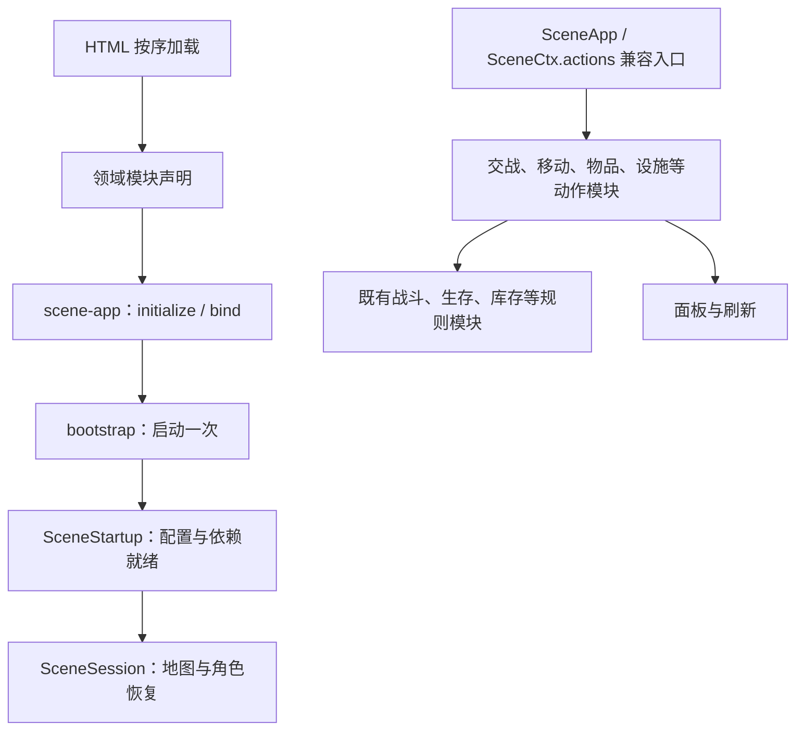

# 场景入口与模块归属规则

生效：2026-11-08。用户要求：主 JS 只作为入口，实际逻辑不得重新写回。此文替代旧拆解计划中允许入口保留门控、跨系统编排和面板实现的口径。玩法数值仍以各设计正本为准。

## 入口的唯一职责

`js/scene-app.js` 只能按登记次序调用每个模块的 `initialize()`，再调用每个模块的 `bind()`。没有游戏状态、规则函数、计算、条件、循环、业务回调、DOM 操作、动态加载或 `eval`。入口不是生成产物，不能从某个大文件重新生成。

`index.html` 和正式敌人试玩页先同步加载各模块，再加载入口，最后加载 `bootstrap.js`。入口链不得使用 `async`、`defer`、模块脚本或重复加载。`bootstrap.js` 继续负责 DOM 就绪与单次启动；保持 `AppBoot.ready` 的原契约。

## 逻辑应放在哪里

完整、机器可检查的目录在 [scene-modules.json](scene-modules.json)：每个模块必须登记职责、公开接口、可写接口、场景依赖、验证文件。当前 33 个模块都是可直接维护的源码。

| 改动内容 | 所属位置 |
|---|---|
| 一轮交战：选肢、选招、先后手、同速提交、重复攻击、资源收尾 | `js/scene/combat-exchange.js` 的 `CombatExchange.attackEnemy` |
| 伤害公式、命中、招架、承伤、击退、死亡 | 既有 `combat-damage`、`combat-melee-resolve`、`combat-pipeline`、`combat-initiative`、`combat-world`、`death-system` 等规则模块；不得复制到交战入口 |
| 朝向、步行、等待、蹑步、交互路由 | `js/scene/movement.js` |
| 行动资格、失能、界面互斥、给药门禁 | `js/scene/access.js`，交战状态统一读 `CombatEngagement` |
| 世界刻与已存在的各系统后置顺序 | `js/scene/world.js`，各系统仍自行拥有结算实现 |
| 健康／活力实际损毁经验 | `SurvivalSkills` 定义发奖策略，`CharacterAttributes` 提供实际变化量，`CombatPipeline` 聚合整招、`CombatWorld` 完成延迟位移后发奖；等级与经验仍唯一归 `InventoryEquipment`。休息每刻与交战动作由原场景拥有者调用保存事务 |
| 物品使用、装备、快捷栏使用及事务 | `js/scene/items.js`，物品效果仍在 `item-use.js` 等原规则模块 |
| 急救包补充、治疗、手术进度与部位经验奖励资格、改造与保存事务 | `js/scene/medical.js`；储量与用量规则在 `js/medical-kit.js`，身体上限与恢复仍归 `CharacterAttributes`，技能等级与经验仍归 `InventoryEquipment` |
| 急救包日常面板 | `js/scene/medical-panel.js`；原生与 Svelte 共用 `js/medical-kit-view.js` 和 `css/medical-kit.css` |
| 制作台用品与工具生产、工位建设及升级事务 | `js/scene/manufacturing.js`，台级／工作进度归 ManufacturingActions；知识仍归 ManufacturingKnowledge |
| 制作台标签与急救包改装视图 | `js/scene/manufacturing-panel.js`，改装调用 MedicalActions 并复用 MedicalKitView |
| 农业、畜牧、仓库、站点动作及会话 | `js/scene/agriculture.js`、`livestock.js`、`warehouse.js`、`station.js` |
| 采集、休息、调息、睡眠准备和动作菜单 | `js/scene/actions.js` |
| 配置加载、地图装载、建角、恢复角色 | `config.js`、`map.js`、`character.js`、`session.js` |
| 原生 HUD、背包、战斗、肌肉、技能、存档、窗口、调试 | 对应 `status/inventory/combat/muscles/skills/saves/windows/debug` 模块；Svelte 界面继续维护 `ui/src` |
| 文案反馈、上下文、导航、招式展示辅助 | `feedback/context/navigation/selection` 模块 |
| 启动依赖与旧接口接线 | `startup.js`、`public.js`，仅绑定、等待和转发，不实现业务规则 |

`startup.js`、`public.js` 也不能成为新的大入口：禁止业务公式、循环、资源扣除、存档事务、规则管线调用和玩法状态赋值；新增调用必须进入 `compositionCalls` 并审查用途。不得改名为 `runtime/manager/context/helper` 后塞回所有实现。

## 状态、接口与加载契约

1. **一个状态只有一个拥有者。** 定时器、面板开关、临时动作状态留在所属模块闭包。角色、物品、农业存档继续由原系统拥有，不在新模块复制一份。
2. **接口按完整动作暴露。** 外部调用“攻击敌人”“使用物品”“收获”，不把扣资源、判定、提交拆散给各界面自行拼装。私有辅助函数留在模块内。
3. **跨模块读写必须显式。** 使用登记的 `window.Module.member`，不引入共享可写大对象或另一个全局变量袋。已有兼容 getter/setter 必须记录在清单；新增 setter 必须说明所有权及调用者，优先使用命令或配置方法。
4. **initialize 只初始化本模块。** 模块声明阶段不执行业务；先初始化所有模块，再绑定事件和兼容出口。`bind` 不启动交战、扣料或推进时间。运行期加载和恢复由 `SceneStartup` / `SceneSession` 管理。
5. **展示层不拥有玩法。** 原生与 Svelte 入口调用同一动作；面板只表达状态和请求，不计算第二套伤害、奖励或事务。
6. **兼容出口只转发。** `SceneApp` 和 `SceneCtx.actions` 保留旧调用者，新的内部代码直接依赖领域接口。不得在兼容出口补业务判断或匿名长回调。
7. **重构不得夹带玩法改动。** 数值、结算顺序、同速锁定、失败退回、时间与保存键保持。发现文档与实现冲突，记录到 [战斗规则映射](combat-rule-map.md)，另行按用户决定修正。
8. **按职责拆，不按行数拆。** 禁止 `part1/part2`、复制粘贴同一规则、绕过接口访问私有状态。当前模块间仍有历史依赖；本轮不声称已消除所有耦合。

## 后续改动流程

1. 在清单与规则映射中找到拥有者；已有模块能承担的逻辑直接在那里修改。
2. 确需新模块时，先写清“拥有何种状态、对外完成何种动作、依赖谁、如何验证”。把文件、接口、依赖与测试登记到清单，并更新两个入口页面和入口的生命周期调用。
3. 新规则要通过完整动作接口验证成功、拒绝、资源与时间、保存失败，以及适用的多段/同速/读档场景。测试可以替换库存、时钟等外部适配器；不得截取主文件文本执行、复制生产算法或仅凭字符串存在宣称行为正确。
4. 运行 `npm test`。跨战斗、时间、设施或界面改动再运行 `npm run test:scene-regression`，以及清单中受影响模块的专项测试。已有失败也必须报告，不可跳过后宣称全绿。
5. 评审时同时检查实现、清单和测试；不能为了放行把业务调用改名、删除检查或将整个模块加入豁免。新增接线调用的清单登记不代替语义评审。

## 自动约束

`npm run check:architecture` 对入口使用 AST 白名单，只接受登记的同步初始化和接线调用；检查模块登记、公开接口、可写接口、依赖、重复函数、测试文件与页面脚本加载。它也约束两个接线模块的赋值和调用。

`npm run test:scene-architecture` 会故意注入业务函数、状态、DOM 修改、回调、生成器、异步入口、乱序加载及接线模块直接写状态，确认检查会拒绝。`npm test` 包含这些防退化测试与完整动作回归。常规开发启动和两个 UI 构建命令都先执行结构检查；GitHub 工作流执行 `npm test`。

检查不是安全沙箱，也不能自动判断一个正常领域函数是否职责过宽。目录归属、规则唯一性和新增公开接口仍须代码评审。不得用手工启动绕过检查后宣布交付完成。

## 本次迁移边界

本轮从当时工作区的 `scene-app.js` 按职责迁移，保留此前未提交改动；没有重写战斗公式、改存档格式或实现尚未确认的设计。迁移脚本与快照只在 `tmp` 留作审计，后续直接维护正式模块，不把临时脚本当构建步骤。验证记录见 [scene-refactor-verification.md](scene-refactor-verification.md)。
