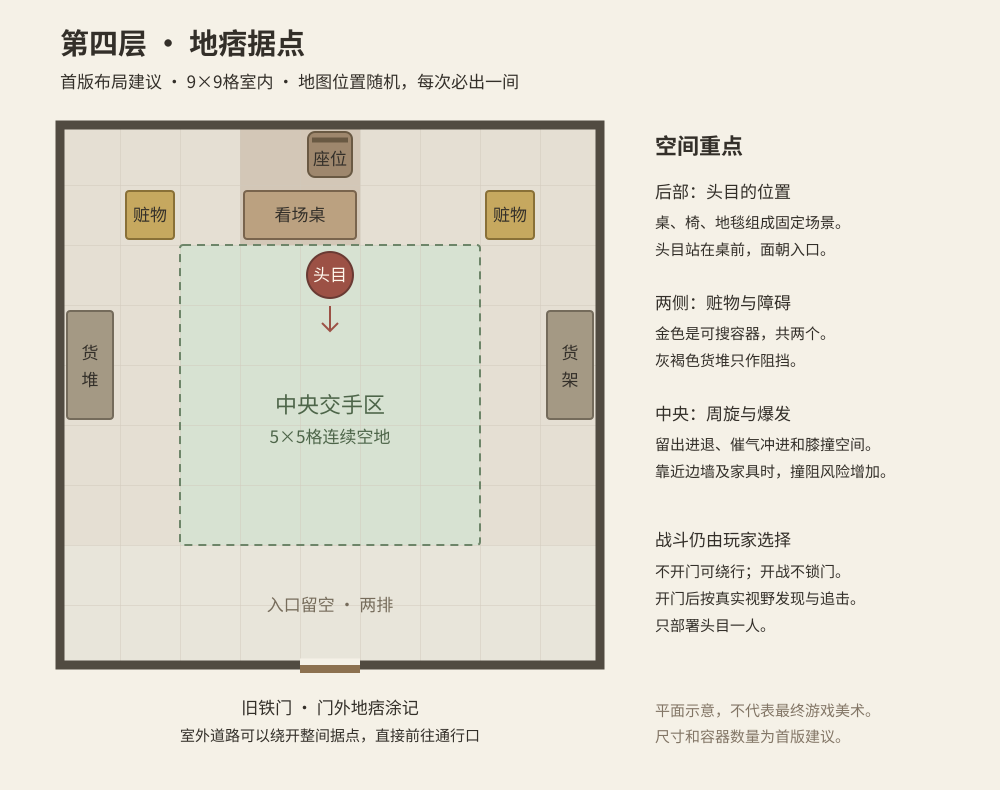

# 75 第四层地痞据点

## 2026-10-31 头目概率与奖励配置

小屋及两个特殊容器仍固定生成，头目本人改为读取配置，以60%概率出现。未抽中时不调走普通敌人；抽中时沿用下文固定站位与额度调配。私藏箱、赃物袋筐和头目尸体的奖励可分别配置，当前只开放配置入口，额外掉落留空。详见[头目出现率与掉落配置](../dungeon/ruins-v14/BOSS-CONFIG.md)。本节优先于历史必定投放一名头目的描述，结构定稿不变。

## 2026-10-30 正式定稿与部署

用户确认当前头目小屋定稿，要求每次生成保持这一结构。新生成第四层已接入固定模板 `street-thug-den-v6`：**5×8格室内，7×10格墙体外框**。10件家具／地形、2种专属容器、门位置、头目初始站位、摆放朝向与墙面装饰完全固定，只允许整间平移到随机地图中的空地；不旋转、不镜像，不按普通空房、无门或主题配置重新填充。

数据源为v6目录的 `room-template.json`（结构与占格）、`default-layout.json`（用户导出坐标）和 `manifest.json`（美术登记），由 `tools/build-boss-room-template.mjs` 生成运行数据。试场与正式楼层共用模板、美术与墙地绘制，个人拖拽草稿不进入正式生成。

从本层既有敌人及容器额度调配1名头目和2个容器，优先调配普通室内敌人，极端空房配置下可调配游荡敌人额度。小屋位于不覆盖既有建筑、道路和内容点的空地，外侧保留一格接路区域。提交前检查全图通路、门外可达、所有内容房关门后入口到撤离点仍连通；没有合格位置则触发现有楼层重试，不接受缺房或结构缩水。门固定铁门，初始关闭，开门、AI、搜刮、脱战与退出按现有规则；战斗不锁门，头目仍可不打。

只在生成时应用，读取已有楼层不再运行模板部署，保留原房间、敌人伤势／死亡、门状态和搜索进度。主角与头目显示125%，尸体使用共用面粉袋v3。检视页为 `tools/street-thug-boss-room-generation.html`，可更换种子查看正式第四层；原布局页保留。

验证包含24组种子（普通、全无门、极端空房各8组），逐格对照墙门、家具占格、容器与头目站位，同时检查碰撞、柱／半墙视线、额度与撤离通路。另检查正式逐层进入、战斗、存读档和自选撤离。以下为形成该定稿前的历史方案，尺寸或状态冲突以本节为准。

2026-10-29 当前美术候选为 [76号v6](76-street-thug-boss-room-art.md)：用户要求全房按棋格重绘、恢复已确认的手绘画风，并增加符合背景的使用与修补痕迹。保留5×8室内和3×4净空；桌柜底面扩展至整格、床与货架各1×2格，按底面接触点登记尺寸。床铺取消帘架，隔断仍围出休息角；桌椅、柜门、货架与容器均按可用正面朝通道。家具是混用旧物，局部修补和杂物有使用原因，通路保留。本轮选用参数以v6素材清单为准，替代下文历史尺寸，仍未改变正式生成。

2026-10-29 当前棋盘候选 v4（替代下文9×10与7×8候选）：用户指出房间缺乏人居感、家具方向无逻辑，并要求考虑物件和人物比例。现将试场收紧为 **5×8格室内**，中央3×4格净空；后部为收账桌椅与窗下洗漱柜，西北床铺由贴墙半隔断和端柱围出，门侧为周转货架与赃物筐。墙使用较薄的双面围合，补墙裙、窗框、值班表、停用灯管和线管；近侧墙以剖面显示，碰撞与视线仍使用正式格子规则。室外改为安静的旧水泥材质，保留不进入房间的撤离路线。

家具以正式主角与头目为尺度基准，人物资产、显示尺寸、底座和阴影均未改动。桌面约33px、客凳坐面约23px、床面约26px、洗漱柜面约34px（144px格宽下，沿同一根竖直支撑边估测，非PNG包围盒高度）；铁门约91px。桌椅贴近成组，床侧朝室内，货架取货面与筐口朝过道，私藏箱开口朝可达格。具体显示参数与源图测量点在 `tools/street-thug-boss-room-scale.mjs`，两种容器搜空前后沿用同一筐／箱体比例。试场新增同尺寸人物—家具对照，以及可关闭的朝向箭头。

此版是美术与布局候选，不改变正式第四层生成或玩家存档。保留唯一头目、两种容器、门内落脚格到头目至少5个合法八向步、超过60%室内可走、全部空地正交连通、每个容器至少两个正交接近格。自动检查包含真实移动、转角阻挡、柱／半墙视线、操作面方向与状态往返。原5×5交手区是较大候选的方案，本次缩为3×4，须按实际交手观感继续评审，不将自动检查等同战斗平衡验收。

2026-10-29棋盘地形候选：用户要求补充地形，并放到实际游戏棋盘看效果。新增[正式棋盘试场](../../tools/street-thug-boss-room-board.html)，使用正式游戏的绘制、人物、移动、碰撞、门、视线和战斗，独立内存存储。为容纳门内两格短矮墙、右侧一格承重柱与右下2×2碎砖区，室内从7×8扩为 **9×10格**；中央保留连续5×5格。矮墙、碎砖挡移动而不挡视线；柱子同时挡视线。家具逐格登记占位，床、桌、货架各占两格；保留两种可搜容器、单一头目和室外绕行路。全景是缩小正式画面并临时展示所有布置，切换主角视野则恢复真实遮挡；默认头目待机，可开启真实AI交手。此版不新增可站立高差、跳跃或地形伤害规则，也没有接入随机楼层生成。布局、可达性、转角通行、柱／矮墙视线及存储往返已检查；仍待用户评审。

2026-10-29最新纠正：用户指出生活区候选过于木制、古风，要求回到游戏仍留有现代社会痕迹的背景。美术身份调整为 **被地头蛇占用的旧厂房值班室**：钢架贴面桌、塑料凳、铁床、旧人造革椅、铁柜与周转货架；水泥地及旧工业设施保留。7×8生活分区和中央5×5净空方向继续，少量旧木箱／藤筐作为混用旧物保留。电扇、灯管停用，只有小电池工作灯提供局部暖光，不因此增加充电或恢复功能。详见[76号最新美术修订](76-street-thug-boss-room-art.md)。本条优先于下文木地板及整套木家具描述；当前仍为独立预览，正式部署规则不变。

2026-10-29追加：用户认为首版缺乏人居感，认可参考快活林的看场生意、龙门客栈的生活分区及威虎山的主位关系，并要求先做一版。独立美术页现默认展示 **7×8生活据点候选**：后侧吃喝收账桌与扶手椅、侧后铺位和私藏箱、相邻茶水洗漱柜、门边赃物筐与封扎货物；中央保留5×5无家具区。两种可搜容器按用途放置，不再要求左右对称。旧9×9仓库布局保留对照。此候选取代下文首版的美术摆放建议，尚不代表正式生成与碰撞验收；唯一头目、可绕行、不锁门、两容器来自本层额度等规则继续有效。详见[76号美术更新](76-street-thug-boss-room-art.md)。

2026-10-28，房间设计稿 v1。用户已确定第四层固定出现头目的专属内容房，并选择「地痞据点：看场桌、赃物堆和头目座位」主题。挑战继续自选。下述布局、尺寸和容器数量为首版方案；专属布景尚未接入游戏，当前运行版本仍在普通有门敌人房中部署头目。

2026-10-29，美术素材第一版见[76号设计](76-street-thug-boss-room-art.md)：已制作看场桌、头目座椅、封扎货堆和门边涂记。用户追加要求的两种专属容器为头目私藏箱与赃物袋筐，各有未搜／搜空两态，替代原通用容器搭配；墙地面、地毯和货架继续复用。当前为独立美术预览。

## 房间身份与出现规则

一间被头目长期占用的旧仓库。后墙的座位和看场桌显示他在这里管事，两侧集中摆放搜刮来的杂物，中央被腾出来供人员走动和交手。家具破旧但摆放有秩序，保留生活使用痕迹。

第四层每次生成恰有一间，据点内只有一名地头头目。房间内容固定出现，地图位置随种子变化；生成时优先保留合适建筑，避免被普通空房、废弃状态或其他主题占用。入口到通行口始终保留不经过据点门和室内的道路。关闭全部内容房仍须能撤离。

头目继续使用[74号完整配表](74-street-thug-boss-design.md)：功夫约120级、底气500，普通招固定耗14、扯领膝撞耗21。发现、追击、脱战、恢复和招式条件沿用正式规则。

## 首版空间方案

图以9×9格室内为例，不含墙和门。实际建筑可旋转、镜像和调整边缘形状，保持入口、中央交手区、后部桌椅及侧边赃物的相对关系。中央至少容纳一片连续5×5格地板，家具集中在其外侧；头目可以站在这片空间的后缘。

| 区域 | 内容与占位 | 用途 |
|---|---|---|
| 门外 | 旧铁门，门边有地痞涂记和搬运货物的擦痕 | 在实际看见门口后识别据点，不提前揭示内部或全层位置 |
| 门内 | 两排空地，门槛及内外落脚格留空 | 提供进出空间；开门仍推进时间，入口不提供免战保护 |
| 后墙座位 | 一把破旧、有靠背的椅子，占1格；小块磨损地毯铺在桌椅区 | 作为头目的固定位置标识；头目使用现有站立棋子，初始站在桌前 |
| 看场桌 | 横放的旧桌，占2格，桌上画入账本、搪瓷杯和零散杂物 | 形成管事的生活场景；桌面物件作为整件装饰，不增加独立交互点 |
| 两侧赃物 | 左右各1个真实可搜容器：头目私藏箱与赃物袋筐；边墙另有紧凑的封死货堆或货架 | 两种容器各有未搜／搜空外观，与不可搜装饰区分，保持原物件比例 |
| 中央交手区 | 约5×5格，地面为磨损水泥，家具不切断这片区域 | 容纳接近、退让和催气冲进，让膝撞的拉拽与上顶清楚可见 |

头目初始面朝入口，离门内落脚格至少5个合法八向步；距离按实际障碍计算。家具、容器与初始敌人占位后，至少60%室内地板可行走，全部空地正交连通。每个容器至少有两个可达正交操作格，八向移动不能穿家具角或墙角。

图中的两侧障碍各占2格，主要形成靠边的风险区。布局不叠加普通据点的横贯房间隔断。所有碰撞按物件真实占格登记，低矮家具沿用现有视线规则；地毯不阻挡移动或视线。

## 交战与探索

玩家在中央有空间调整位置，靠近墙、桌子或货堆时，头目的推搡和催气击退更容易造成撞阻。失衡再接扯领膝撞仍由现有条件选招决定，房间不额外强制连招或增加攻击次数。

不开门可以直接绕行。开门沿用现有铁门费用与世界时间规则，头目依据真实视野发现玩家；发现后可以追出门，离开房间不立即清除仇恨。开战不锁门、不封出口。丢失视野超过现有阈值后才进入回位，伤势和资源按既有规则恢复，不瞬间补满。

容器使用正常搜索流程，操作推进世界时间，不要求击杀头目才解锁。两个容器从本层已有额度调配，沿用现有判空、有限库存与领取规则。具体专属掉落及额外奖励另定，本版不把桌面账本设为任务道具，也不额外放恢复点或领悟点。

头目死亡使用已有面包／面粉袋式尸体棋子，尸体搜刮和标记沿用正式流程。桌椅、容器与布景保持原位，搜索与领取进度进入存档。

## 接入与验收要求

生成时先保留据点，再分配普通房间内容；后续装饰、容器外观分配和无门覆写不能覆盖据点布局。最终结果必须同时满足一个头目、一间专属房、室内可达和室外撤离可达，失败时换候选建筑或沿用楼层生成重试，不能静默漏掉据点。

新布局只用于之后生成的第四层。读取已经生成的楼层保留原房间和敌人实例，不补刷、移动或复活头目，也不重置已搜索容器。

验收时检查多种地图种子、全无门和空房倾向覆盖下的唯一性与绕行；在正式地图尺寸检查桌椅、赃物、角色和特效的比例、遮挡及落脚；实际完成进门、接战、退走、脱战回位、搜刮与存读档。布局图只表达空间，不替代实际生成和视觉验收。

关联：[正式地牢接入](dungeon-runtime-integration.md)、[普通据点规则](../dungeon/ruins-v13/OUTPOSTS.md)、[内容房与特别内容](../dungeon/ruins-v13/FLOOR-CONTENT.md)。
